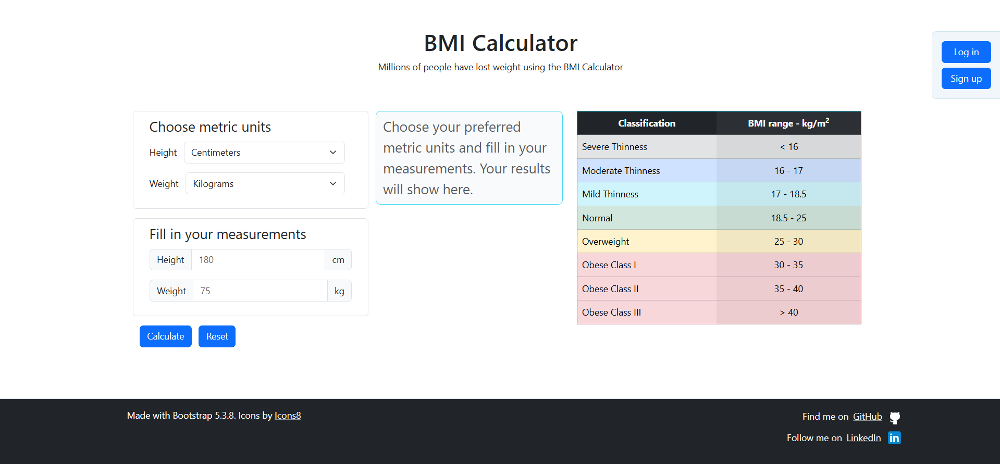

# BMI Calculator v1.0.0

A simple, user-friendly BMI calculator with the option to store and keep track of your measurements as well as see useful statistics of them.

---
## Screenshot

[

---
## Features (current version)

* Enter your weight (kg or pounds) and height (centimeters or feet/inches) and find out your BMI and BMI range.
* Create an account to store, keep track of, and see general statistics of your measurements over time.

---

## Technologies Used

* **Frontend:** HTML5/Bootstrap/JavaScript.
* **Backend:** API implemented with Managed Azure Functions.
* **Database**: PostgreSQL hosted in an Azure PostgreSQL Flexible Server. I used psycopg for database connection.

---
## License

This project is distributed under the MIT License. See the `LICENSE` file for the full text and details.

---
